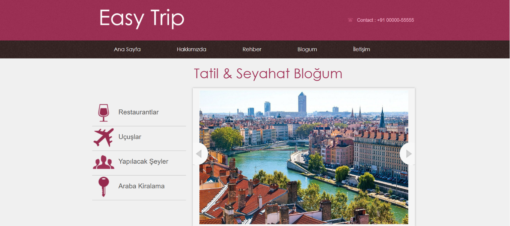
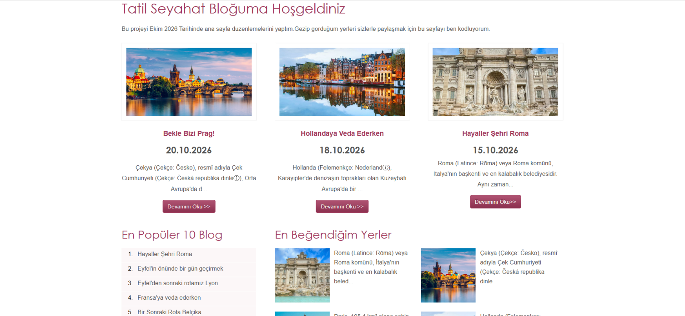
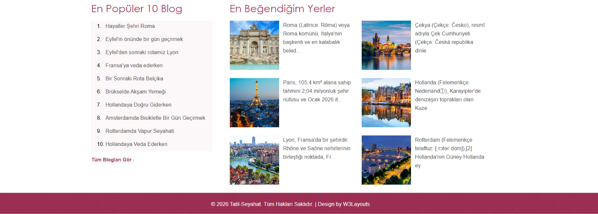
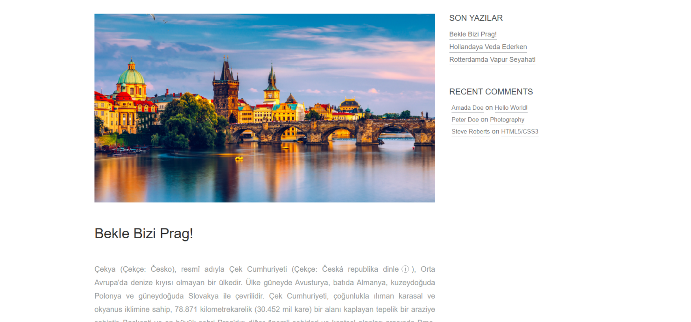
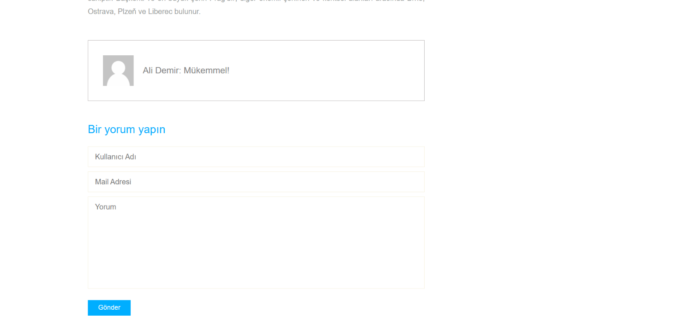
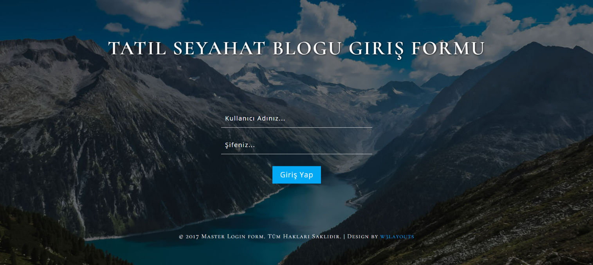
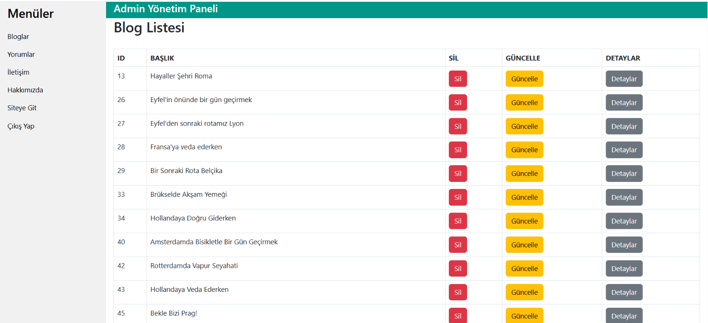
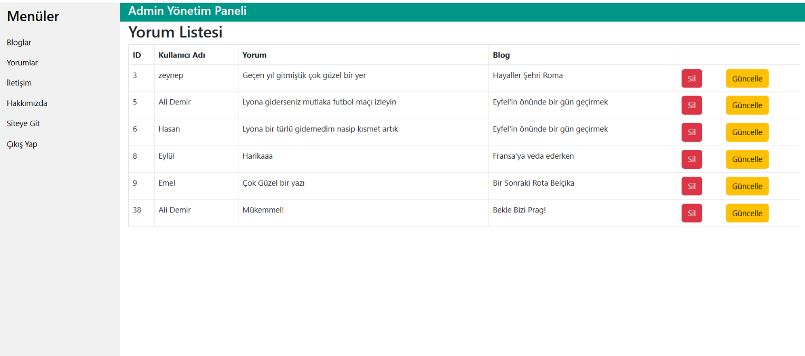

# TravelTrip

ASP.NET MVC ile geliştirilmiş, yönetim paneli bulunan bir seyahat ve blog uygulaması.

TravelTrip, Murat Yücedağ tarafından hazırlanan **50 Derste ASP.NET MVC ile Tatil & Seyahat Sitesi** eğitim serisi takip edilerek geliştirilmiştir. Projede MVC yapısı, Entity Framework ile veritabanı işlemleri ve yönetim paneli geliştirme konuları uygulamalı olarak çalışılmıştır.

## Özellikler

### Ziyaretçi Sayfaları

- Blog yazılarını listeleme ve detaylarını görüntüleme
- Bir blog yazısına yorum ekleme ve ilgili yorumları görüntüleme
- Son eklenen yazıları listeleme
- Ana sayfada veritabanından gelen blog içerikleri
- Veritabanına bağlı Hakkımızda sayfası

### Yönetim Paneli

- Yönetici girişi ve çıkışı
- Yönetim paneline kimlik doğrulama ile erişim
- Blog ekleme, listeleme, güncelleme ve silme
- Yorum listeleme, güncelleme ve silme

## Teknolojiler

| Teknoloji | Sürüm / Kullanım |
| --- | --- |
| C# | Sunucu tarafı uygulama kodu |
| .NET Framework | 4.8 |
| ASP.NET MVC | 5.2.9 |
| Entity Framework | 6.5.2, Code First |
| SQL Server | Veri saklama |
| LINQ | Filtreleme, sıralama ve listeleme |
| Razor | Dinamik HTML görünümleri |
| Layout ve Partial View | Ortak sayfa düzenleri ve bölümler |
| HTML, CSS, JavaScript | Arayüz |
| Bootstrap | NuGet paket sürümü 5.2.3 |
| jQuery | NuGet paket sürümü 3.7.0 |
| Forms Authentication | Yönetici oturumu |

Sürümler `TravelTripProje.csproj` ve `packages.config` dosyalarından alınmıştır. Şablon klasörlerindeki JavaScript ve CSS dosyaları NuGet paketlerinden bağımsız sürümler içerebilir.

## Proje Yapısı

```text
App_Start/        Rota, filtre ve bundle ayarları
Controllers/      İsteklerin karşılanması ve veritabanı işlemleri
Models/Sınıflar/   Entity sınıfları, DbContext ve görünüm veri yapıları
Migrations/       Entity Framework migration yapılandırması
Views/            Razor görünümleri, layout ve partial view dosyaları
Content/          Stil dosyaları
Scripts/          JavaScript kütüphaneleri
web/              Site şablon dosyaları
web2/             Ek şablon dosyaları
weblogin/         Giriş ekranı şablon dosyaları
docs/images/      README ekran görüntüleri
```

## Yerelde Çalıştırma

1. Windows üzerinde Visual Studio'yu, ASP.NET ve web geliştirme iş yükünü ve .NET Framework 4.8 geliştirme araçlarını kurun.
2. SQL Server veya SQL Server Express örneğinizin erişilebilir olduğundan emin olun.
3. Depoyu indirin veya klonlayın:

   ```bash
   git clone https://github.com/mahiremrctn/travel-trip-mvc.git
   ```

4. Visual Studio'da çözüm dosyasını açın. Çözüm dosyası yoksa `TravelTripProje.csproj` dosyasını açın.
5. NuGet paketlerini geri yükleyin (Restore NuGet Packages).
6. `Web.config` içindeki bağlantı dizesini kendi SQL Server örneğinize ve veritabanınıza göre düzenleyin. Gerçek parolaları Git'e göndermeyin.
7. Package Manager Console'da varsayılan proje olarak TravelTripProje'yi seçin ve kendi geliştirme veritabanınız için çalıştırın:

   ```powershell
   Update-Database
   ```

   Projede otomatik migration etkinleştirilmiştir. Bu komut veritabanı şemasını günceller; örnek blog içeriklerini veya yönetici hesabını otomatik oluşturmaz.

8. Projeyi derleyip Visual Studio'dan çalıştırın.
9. Açılan yerel adresin sonuna `/Default/Index` ekleyerek seyahat ana sayfasına gidin. Varsayılan rota `/Home/Index` sayfasını açar.

### Önemli Adresler

- `/Default/Index`: Seyahat ana sayfası
- `/Blog/Index`: Blog listesi
- `/About/Index`: Hakkımızda
- `/GirisYap/Login`: Yönetici girişi
- `/Admin/Index`: Yönetim paneli (giriş gerektirir)

Otomatik örnek veri ve yönetici hesabı oluşturma işlemi bulunmamaktadır. Giriş için geliştirme veritabanında uygun bir yönetici kaydı bulunmalıdır. Bazı ana sayfa sorguları belirli kayıt kimliklerine bağlıdır; boş veritabanında ilgili bölümler içerik göstermeyebilir.

## Öğrenme Kazanımları

- MVC yapısında Model, View ve Controller sorumluluklarını uygulama
- Entity Framework ile CRUD işlemleri
- Blog ve yorum arasındaki bire çok ilişkinin modellenmesi
- LINQ ile veri filtreleme ve sıralama
- Razor'a model aktarma
- Layout ve Partial View ile arayüzü bölümlere ayırma
- Forms Authentication ve `[Authorize]` ile erişim kontrolü

## Geliştirme Notları

Bu proje eğitim amacıyla hazırlanmıştır. Canlı kullanım öncesinde güvenlik ve veri doğrulama iyileştirmeleri yapılmalıdır.

## Eğitim ve Tasarım Kaynağı

Proje, Murat Yücedağ tarafından hazırlanan [50 Derste ASP.NET MVC ile Tatil & Seyahat Sitesi](https://www.youtube.com/playlist?list=PLKnjBHu2xXNNhJQ6SyF7Wyhqza9mkMGSw) eğitim serisi takip edilerek hazırlanmıştır. Eğitim ve rehberliği için kendisine teşekkür ederim. Kullanılan şablonların kendi kaynak ve lisans bildirimleri geçerlidir.

## Ekran Görüntüleri

### Ana sayfa



### Ana sayfa blog kartları



### Ana sayfa blog bölümleri



### Blog detay sayfası



### Yorumlar ve yorum formu



### Yönetici girişi



### Admin blog yönetimi



### Admin yorum yönetimi



